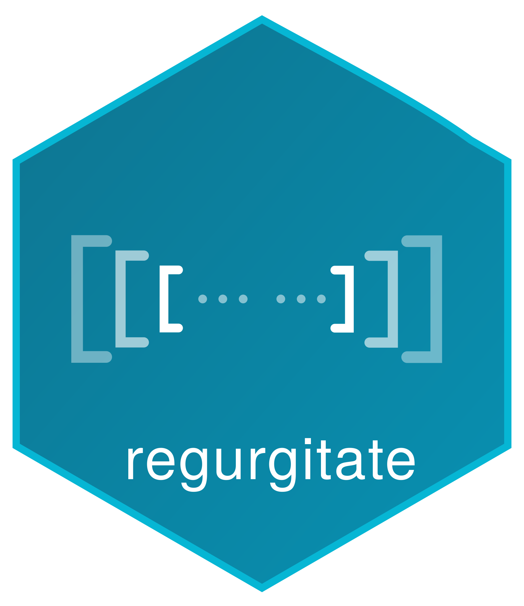

# regurgitate  

The regurgitate Quarto extension collects code blocks and their execution results, placing them in a "Code Appendix" at the end of your document.

## Installation

To install the `regurgitate` Quarto extension, follow these steps:

1. Open your terminal.
2. Execute the following command:

```sh
quarto add coatless-quarto/regurgitate
```

This command will download and install the Quarto extension under the `_extensions` subdirectory of your Quarto project. If you are using version control, ensure that you include this directory in your repository.

## Usage

Add the `regurgitate` filter to your document's YAML front matter:

```yaml
---
title: "My Document"
filters:
  - regurgitate
---
```

That's it! All code blocks will now appear in an appendix at the end.

## Configuration

Three of the extension's options control where code and results appear:

```yaml
extensions:
  regurgitate:
    group-by-language: false      # Group by programming language
    show-code-inline: true        # Show code in original positions
    show-output-results: true     # Include execution results in appendix
```

### Option Details

- **`group-by-language`** (default: `false`)
  - `false`: Appendix code in document order
  - `true`: Appendix grouped by language (Python, R, etc.)
- **`show-code-inline`** (default: `true`)
  - `true`: Code appears both inline and in appendix
  - `false`: Code only in appendix (removed from inline)
- **`show-output-results`** (default: `true`)
  - `true`: Include execution output in appendix
  - `false`: Only code in appendix (no output)

## Learn more

- [Documentation](https://quarto.thecoatlessprofessor.com/regurgitate/)
- [Release notes](https://quarto.thecoatlessprofessor.com/regurgitate/qregurgitate-release-notes.html)
- [Blog posts](https://blog.thecoatlessprofessor.com/projects/regurgitate/)

## License

regurgitate is licensed under AGPL-3.0-or-later with an exception: what you write and render with regurgitate stays yours, along with the output, under any terms you like. See [LICENSE](LICENSE) and [LICENSE-EXCEPTION.md](LICENSE-EXCEPTION.md).
